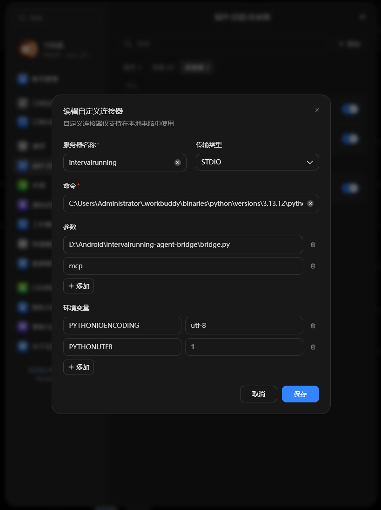

# intervalrunning 智能体桥接服务

一个进程两副面孔：对手机跑 UDP 发现 + HTTP（端口 47823），对智能体跑 MCP（stdio）。两边共用 `data/store.json`。只用 Python 3.7+ 标准库，无需安装任何东西。

计划写入走**五步闭环**：生成 → 自检 → 提交 → 等手机验收 → 只有 `APPLIED` 才算完成；提交成功不等于手机落盘。详见第四章。

## 一、让手机连上（选一种）

**方式 A：常驻服务（推荐，手机随时可连）**

```
python bridge.py serve
```

窗口别关。这一条同时提供发现和 HTTP 服务。

**方式 B：依赖 MCP 会话**

什么都不用做。WorkBuddy 加载 MCP 后会自动拉起网络服务；会话结束就停。

端口固定在 47823，与手机 App 里写死的一致。电脑和手机必须在同一局域网，电脑防火墙要放行 47823（UDP + TCP）。

## 二、手机端操作

设置页 → 数据共享接口 → 打开开关 → 搜索设备 → 选中「WorkBuddy 智能体桥」→ 连接。

- 只读：能上传训练历史与课表数据（供智能体读取）
- 读写：额外能接收训练计划，以及智能体下发的课表数据并落库
- 课表读取权限两种档位都生效；课表写入、计划写入只在读写档生效，桥端与手机端双重校验。云端不参与，仅局域网自有设备。
- 连接后**自动同步**（打开开关/连接成功立即一次，之后每 15 秒），不需要在 App 里点按钮；
  智能体写入新计划时，App 会先把旧计划归档再生效，不会直接覆盖。
- 权限档位在 App 代码里配置，面板只读展示，不提供二次切换。

## 三、协议（v1）

手机与桥接服务之间走 HTTP + JSON，端口 47823。

| 方法 | 路径 | 鉴权 | 用途 |
|---|---|---|---|
| POST | `/v1/pair` | 无 | 连接：登记令牌、权限档位、设备标识与时区 |
| POST | `/v1/sessions` | 需令牌 | 上传训练历史（全量） |
| POST | `/v1/plan` | 需令牌 + 读写档 | 手机把当前计划推给桥端；必须带 `baseRevision`，期间智能体写过新计划则 409 |
| GET | `/v1/plan` | 需令牌 + 读写档 | 手机从桥端拉取计划 |
| POST | `/v1/plan/result` | 需令牌 + 读写档 | 手机上报验收：`revision` + `status`(`APPLIED`/`REJECTED`) + `problems`；迟到回执只进历史不改当前结论 |
| POST | `/v1/workouts` | 需令牌 | 手机上传课表数据（两种档位均可）；必须带 `baseRevision`，旧版本会 409；已删除 id 不可复活 |
| GET | `/v1/workouts` | 需令牌 + 读写档 | 手机拉取智能体写入的课表数据并落库（写入权限） |
| GET | `/v1/ping` | 需令牌 | 探活：只验桥端可达且令牌有效，不要求写权限。回 `{code:"OK", clientId, permission}`，供手机设置页状态灯使用 |
| UDP | 47823 | 无 | 发现广播，手机发 `{"v":1,"type":"discover","client":"intervalrunning"}`，桥端单播回 `{"v":1,"type":"agent",...}` |

**请求体公共字段**

| 字段 | 说明 |
|---|---|
| `v` | 协议版本，固定 `1` |
| `client` | 客户端标识，固定 `intervalrunning` |
| `token` | 连接令牌（`/v1/pair` 用请求体带，其余用 `X-Agent-Token` 或 `Authorization: Bearer` 头） |
| `permission` | `READ_ONLY` 或 `READ_WRITE`，必须与配对记录一致，否则 403 `PERMISSION_MISMATCH` |
| `clientId` | 设备稳定标识，桥端按它隔离多台手机的记录 |
| `tzId` / `tzOffsetMinutes` | 手机时区，桥端按它把 `yyyy-MM-dd` 换算成 epoch 毫秒 |

**响应体公共字段**

| 字段 | 说明 |
|---|---|
| `code` | 业务码。成功为 `OK`，失败见下表；HTTP 状态码相同可能对应不同含义，**必须读 `code`** |
| `revision` | 智能体计划版本号（仅 `GET /v1/plan`）。智能体每写一次计划 +1，手机按它判断是否要重新拉取 |
| `phoneRevision` | 手机上传计划的独立计数；手机上传只推进它，不动 `revision`，避免手机自己反复拉取 |
| `source` / `writtenAt` | 计划最后由谁写（`agent` / `phone`）以及写入时间，见 `get_status` 的 `plans` |
| `plan` | 计划 JSON（仅 `GET /v1/plan`） |
| `permission` | 桥端为该令牌登记的档位（仅 `GET /v1/ping`） |
| `status` / `stale` | 验收状态与是否迟到回执（仅 `POST /v1/plan/result` 的回执） |

**计划验收闭环**：智能体 `set_plan` 后桥端记 `PENDING`，只有手机通过 `POST /v1/plan/result` 回报 `APPLIED` 才算真正落盘。手机 90 秒内有通信算在线；新版本会重置验收状态，上一版的 `APPLIED` 不会继承给新计划。智能体侧用 `get_plan_status` / `wait_for_plan_result` 读这个结论。

**探活的跨版本约定**：旧版桥端没有 `/v1/ping`，会回 404 `NOT_FOUND`。手机客户端读到该码后改探 `GET /v1/plan`，并把 `OK` / `NO_PLAN` / `PERMISSION_DENIED` 都视为「桥端活着」——这三个业务码能回来，就证明网络可达且令牌被认识。因此只升级 App 不重启桥端，状态灯依然可用。

**错误码**

| code | HTTP | 含义 |
|---|---|---|
| `OK` | 200 | 成功 |
| `UNAUTHORIZED` | 401 | 未配对或令牌失效 |
| `PERMISSION_DENIED` | 403 | 只读档做了写操作 |
| `PERMISSION_MISMATCH` | 403 | 请求体档位与配对记录不一致 |
| `PERMISSION_ESCALATION` | 403 | 同一令牌已登记为只读，不允许直接提权（需重新连接生成新令牌） |
| `TOKEN_CONFLICT` | 403 | 该令牌已绑定另一台设备 |
| `NO_PLAN` | 404 | 桥端还没有计划（**正常空态**，不是故障） |
| `NOT_FOUND` | 404 | 未知端点（**真故障**，不能当空态吞掉） |
| `BAD_REQUEST` | 400 | 请求体不合法 |
| `BAD_VERSION` | 400 | 协议版本不匹配 |
| `BAD_TOKEN` | 400 | 缺少连接令牌 |
| `BAD_PERMISSION` | 400 | 权限值非法 |
| `BAD_PLAN` | 400 | 计划格式不合法 |
| `CONFLICT` | 409 | 计划/课表版本前置条件不满足：期间已有新写入，先拉取再重试 |
| `BAD_SESSIONS` | 400 | sessions 字段不是数组 / 条目缺 id / startedAt 不是数字 / count 与条数不符 |

**设备隔离与提权规则**

- 训练记录按 `clientId::会话id` 两段索引：两台手机的会话 id 都从 1 开始，不隔离就会互相覆盖。
- 计划也按设备分槽存放，互不干扰。
- 同一个令牌只能绑定一台设备，也不能从只读提权成读写。提权需要**断开后重新连接**（手机会生成新令牌）。

## 四、智能体端（MCP 配置）

本机 MCP 配置里加一项（stdio 方式）。**命令和环境变量要用实际值**，别照抄裸 `python`：

```json
{
  "mcpServers": {
    "intervalrunning": {
      "command": "C:\\Users\\Administrator\\.workbuddy\\binaries\\python\\versions\\3.13.12\\python.exe",
      "args": ["D:\\Android\\intervalrunning-agent-bridge\\bridge.py", "mcp"],
      "env": {
        "PYTHONUTF8": "1",
        "PYTHONIOENCODING": "utf-8"
      }
    }
  }
}
```

- `command` 写本机 Python 的绝对路径。GUI 客户端启动子进程时不一定继承 shell 的 PATH，写 `python` 可能启动失败或拿到别的版本（需要 3.7+）。JSON 里反斜杠要写两个（`\\`）。
- `env` 两行强制 UTF-8：桥的回话和日志都是中文，Windows 默认 GBK，不设会乱码，甚至写回话中途报错。

**各客户端在哪配**（入口随版本变化，以当前界面为准；下面三要素都填同一份值）：

| 客户端 | 配置入口 | 方式 |
|---|---|---|
| WorkBuddy | `C:\Users\<用户名>\.workbuddy\mcp.json`，直接编辑 | 文件 |
| 豆包工作 | 左侧「技能 · 连接器 · 伙伴」→「+ 添加 / 新建」→「新建自定义连接器」 | 界面 |
| TRAE CN | 设置 → MCP → 添加自定义 MCP（stdio） | 界面，配置存在应用数据库里，只能走 UI |
| Qoder CN | `C:\Users\<用户名>\.qoder-cn\settings.json` | 文件；同目录 `mcp-router.json` 是运行时文件，不要手改 |

文件方式填上面那份 JSON；界面方式按「服务器名称 / 传输类型 / 命令 / 参数 / 环境变量」逐项填，见下面豆包示例。改完保存，重启客户端才加载。

### 豆包工作客户端

豆包不直接编辑 JSON，走界面：**左侧「技能 · 连接器 · 伙伴」→「+ 添加 / 新建」→「新建自定义连接器」**。未登录时侧边栏被精简，先登录再找入口。按图填写：



| 字段 | 值 |
|---|---|
| 服务器名称 | `intervalrunning` |
| 传输类型 | `STDIO`（默认是 HTTP，本地进程必须选 STDIO） |
| 命令 | 上面那个 Python 绝对路径 |
| 参数 | 两行：`D:\Android\intervalrunning-agent-bridge\bridge.py`、`mcp` |
| 环境变量 | 两行：`PYTHONUTF8` = `1`、`PYTHONIOENCODING` = `utf-8` |

保存后首次可能提示「连接器运行失败」，到「我的技能 → 连接器」点一次「重新启动」即可。自定义连接器只在本机生效，不随账号同步到其他设备。

配好后重启客户端，即可用这几个工具：

| 工具 | 用途 |
|---|---|
| `list_sessions` | 读手机上传的训练历史（支持条数、起始日期、排序、设备过滤） |
| `get_status` | 看配对状态、权限、记录数、上次同步、活跃设备，以及每台设备的计划名/条数/`revision`/`phoneRevision`/`source`/`writtenAt` |
| `validate_plan` | **提交前自检**：按 App 课表规则全字段校验，不写入任何数据。`problems` 非空必须改到为空再提交 |
| `set_plan` | 提交计划。给 `steps` 就是计划内自定义训练，不依赖课表库；回执 `status=PENDING_APP_ACCEPTANCE` 只代表桥端已收，**不代表完成** |
| `get_plan` | 读当前已写入的计划（App 原生 JSON）；读到计划 ≠ 手机已落盘 |
| `get_plan_status` | 查当前版本的手机验收状态（不阻塞）：`PENDING` / `APPLIED` / `REJECTED` / `PHONE_UPLOADED`，`REJECTED` 带手机给的 `problems` |
| `wait_for_plan_result` | 等手机验收（长轮询，默认 45 秒，最长 120 秒）。只有 `APPLIED` 才能宣布完成；`TIMEOUT` / `NO_DEVICE` 都不算成功 |
| `set_plan_json` | 写 App 原生计划 JSON；entry 含 `steps` 而无 `customWorkout` 会自动补编码，无训练内容的 entry 会被拒绝 |
| `list_workouts` | 读取手机上传的课表数据（课表读取权限） |
| `set_workouts` | 写入课表数据（课表写入权限，手机需读写档）；可用 `name + steps` 自动编码。写入范围仅限「我的课表」：带 `isPreset` / `presetKey` 或命中本机内置预设的条目只另存副本，绝不覆盖预设 |
| `delete_workout` | 删除一套自定义课表（兼容单条；内置预设不可删） |
| `delete_workouts` | 批量原子删除自定义课表，支持 `expectedRevision` / `expectedCustomCount` 前置校验；重复提交幂等 |
| `keep_only_custom_workouts` | 原子清理到指定保留列表（如 21→10），版本/数量不符整批拒绝 |

**计划任务的五步闭环**（写在 MCP 握手的 `instructions` 里，模型连上就拿到，任何一步都不能省）：

```
生成 → validate_plan 自检 → set_plan 提交 → wait_for_plan_result 等验收 → 只有 APPLIED 才算完成
```

- 自检 `problems` 非空 → 改到为空再提交；返回 `RULE_VIOLATION` 同理。
- 提交后返回 `PENDING_APP_ACCEPTANCE`，此时**任务未完成**，手机还没落盘。
- `REJECTED` → 按手机给的 `problems` 改，从生成重走；`PENDING` / `TIMEOUT` / `NO_DEVICE` / `PHONE_UPLOADED` 一律不得宣布完成，用 `get_plan_status` 继续查或提示用户检查手机。
- 迟到回执（版本已变）只进历史，不覆盖当前版本的验收结论。

典型用法：让智能体「读最近的训练历史，排一个四周计划」——它会调 `list_sessions` → `list_workouts` → `validate_plan` → `set_plan` → `wait_for_plan_result`，看到 `APPLIED` 才回复完成。

`set_plan_json` 的 entry 原生格式：`id` / `date`(epoch 毫秒) / `hour` / `minute` / `workoutId` / `workoutName` / `customWorkout`(由 `encode_workout_snapshot()` 生成的 JSON 字符串)。若是 `set_plan` 风格的 `steps`，工具会自动编码成 `customWorkout`；`workoutId=0` 又没有任何训练内容的条目会被拒绝，避免手机显示「已删除」。回执会报「App 可解析 N 条」，`get_status` 也提供 `parseableEntries`。

`steps` 支持 `label`（步骤名，接口写入时统一截到 7 个字符）与 `cadenceSpm`（该段节拍器步频）。步频只在 App 的节拍器开启且模式为「跟随段落」时生效；「固定步频」模式使用 App 设置里的全局值，接口无法修改全局节拍器设置。

多台手机同时连着时，`set_plan` / `get_plan` / `list_sessions` 都可以带 `clientId` 指定设备；不带就作用于**当前活跃设备**（最近与桥端通信的那台）。没有任何设备连接时，不带 `clientId` 会直接报错，不再退回一个手机永远不读的 `default` 槽位。智能体写某台设备的计划也不会改变「当前活跃设备」。

## 五、命令

```
python bridge.py mcp       # MCP 模式（默认），同时起网络服务
python bridge.py serve     # 只跑网络服务，前台常驻
python bridge.py status    # 查看当前状态
python bridge.py selftest  # 自检，不改真实数据
python bridge.py mcp --store <其他路径>   # 换数据存储位置
```

## 六、验证脚本

除 `bridge.py selftest` 外，另有五个独立验证脚本，全部不碰真实数据：

| 脚本 | 验证什么 | 项数 |
|---|---|---|
| `bridge.py selftest` | 协议层自检：发现包、鉴权、校验、计划格式、并发写、验收闭环 | 114 |
| `keepalive_check.py` | 长连接复用：一次 403 之后同连接上的后续请求是否仍然正常 | 6 |
| `e2e_check.py` | 端到端联调：按 App 真实协议体走完「连接→上传→智能体写计划→手机拉取→手机回传」 | 26 |
| `migration_check.py` | 旧版 store.json 升级无损 | 15 |
| `concurrency_check.py` | 多进程并发写一条不丢 | 4 |
| `compat_check.py` | 新旧两侧单独升级时仍能互通 | 8 |

## 七、已补的洞（相对裸协议）

- 权限服务端反查：拉计划时按配对记录判 READ_WRITE，只读档直接 403，不信请求体
- 上传包 permission 与配对记录不一致 → 403
- **令牌绑定设备 + 禁止提权**：同一令牌不能改绑别的设备，也不能从只读直接升成读写
- **设备维度隔离**：训练记录按 `clientId::id` 存，计划按设备分槽，多台手机互不覆盖
- 按 session id 去重（upsert），重复上传不产生脏数据
- 统一错误码 JSON：`UNAUTHORIZED` / `PERMISSION_DENIED` / `PERMISSION_MISMATCH` / `PERMISSION_ESCALATION` / `TOKEN_CONFLICT` / `NO_PLAN` 等
- **入参严格校验**：`count` 与实际条数不符、条目缺 id、`startedAt` 不是数字，一律 400 拒绝，不进库
- **计划写入前按 App 的 `decodePlan` 规则校验**：`workoutId=0` 且无有效 `customWorkout` 的条目直接拒绝；`hour`/`minute` 越界、条目日期超出计划周期、空计划也拒绝
- **时区按手机口径**：计划日期换算用手机上报的 `tzId`/`tzOffsetMinutes`，不同时区的手机不会差出一整天
- `set_plan_json` 自动把 `steps` 编成 App 原生 `customWorkout`，回执与 `get_status` 报告 App 可解析条数
- **提交前自检**：`validate_plan` 与 `set_plan` 共用同一套规则校验，不写入数据；规则只在桥端维护一份，不与手机端双写漂移
- **验收闭环**：手机 `POST /v1/plan/result` 回报 `APPLIED`/`REJECTED`，智能体 `get_plan_status`/`wait_for_plan_result` 读结论；迟到回执不覆盖当前版本，`PENDING`/`TIMEOUT` 绝不默认成功
- 规则随 MCP 握手一次性给到模型：五步闭环 + 课表硬规则 + 文本与结构化字段一致性要求（数值必须写进对应字段，`workoutName`/`label` 里出现数值须与字段一致，否则实时提醒不触发）
- 智能体写新计划前先把旧计划留档（`planArchives`），绝不直接删除/覆盖
- 存储原子写 + **跨进程文件锁**：「读-改-写」全程串行，MCP 与 HTTP 分进程运行时也不互相覆盖（修复前实测 75 条只剩 6 条）
- 原子替换带重试：Windows 上目标文件被短暂占用时不会直接失败
- 鉴权失败也会读完请求体：HTTP/1.1 长连接上残留的 body 不会污染下一个请求
- 脏数据（`startedAt` 是字符串等）不会让 `list_sessions` 排序崩溃

## 八、未做（需要时再加）

- HTTPS：当前 HTTP 明文，局域网内使用
- token 撤销/过期：目前配对后长期有效，靠 App 侧「断开」清理本地，桥侧无主动失效
- 计划冲突对话：手机上传带 `baseRevision`，期间智能体写过新计划会返回 409，手机先拉取再传；不做人工选择界面
- 计划按设备分槽后，MCP 侧不写 `clientId` 时作用于活跃设备；多设备场景建议显式指定
