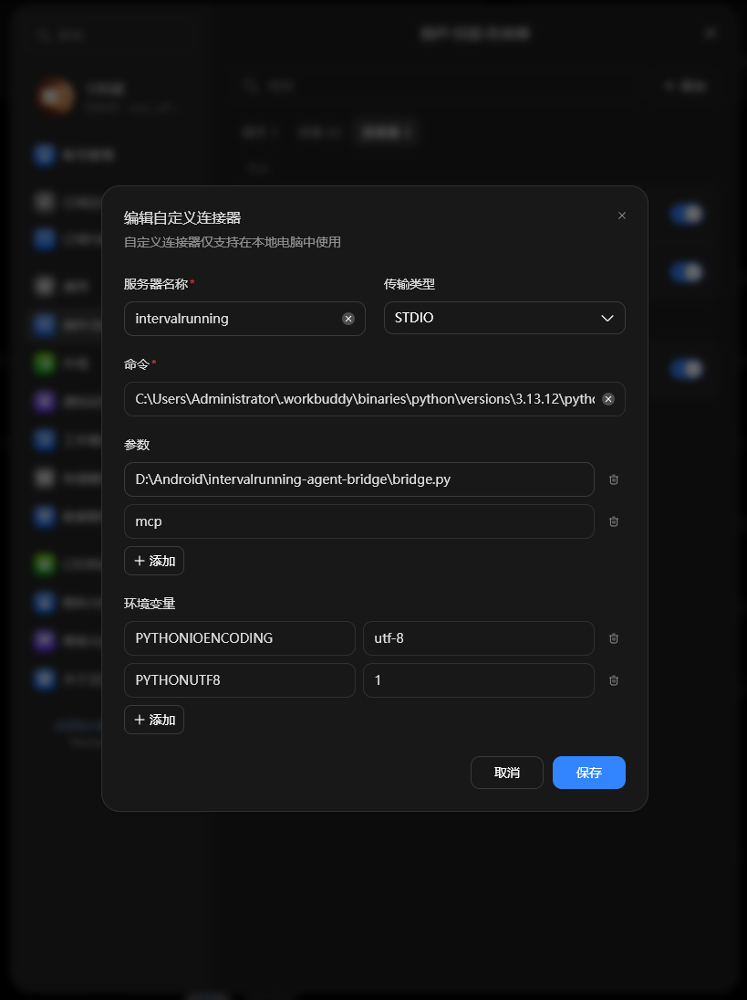

# intervalrunning 智能体桥接服务

让手机 App 和智能体（WorkBuddy、豆包等）互相说话：智能体可以读取你的训练记录和课表，也可以写入训练计划，手机会自动同步。

- 不用装任何东西：只需 Python 3.7+ 标准库。
- 只在本机局域网运行，数据不经过云端。
- 计划写入是**五步闭环**：生成 → 自检 → 提交 → 等手机验收 → 只有手机确认才算完成。

> 需要协议细节、错误码、验证脚本说明？见 [README-full.md](README-full.md)。

---

## 一、让手机连上桥

选一种：

**方式 A：常驻服务（推荐）**

```
python bridge.py serve
```
窗口别关。手机随时都能连。

**方式 B：依赖智能体会话**

什么都不用做。WorkBuddy 加载 MCP 时会自动拉起网络服务；会话结束就停。

> 电脑和手机要在同一局域网，电脑防火墙放行 47823（UDP + TCP）。

## 二、手机端操作

设置页 → 数据共享接口 → 打开开关 → 搜索设备 → 选中「WorkBuddy 智能体桥」→ 连接。

- **只读**：智能体能读你的训练历史、课表。
- **读写**：额外能接收训练计划和课表并落库。
- 连接后自动同步（连上立刻一次，之后每 15 秒），不用在 App 里点按钮。

## 三、智能体端配置（两种方式二选一）

### 方式一：MCP 文件配置（WorkBuddy 等）

编辑配置文件，加入下面这一项：

- WorkBuddy：`C:\Users\<用户名>\.workbuddy\mcp.json`
- Qoder CN：`C:\Users\<用户名>\.qoder-cn\settings.json`（同目录 `mcp-router.json` 是运行时文件，别手改）

```json
{
  "mcpServers": {
    "intervalrunning": {
      "command": "C:\\Users\\Administrator\\.workbuddy\\binaries\\python\\versions\\3.13.12\\python.exe",
      "args": ["D:\\Android\\intervalrunning-agent-bridge\\bridge.py", "mcp"],
      "env": {
        "PYTHONUTF8": "1",
        "PYTHONIOENCODING": "utf-8"
      }
    }
  }
}
```

- `command` 写本机 Python 的绝对路径（GUI 客户端不一定继承 PATH，别写裸 `python`）。JSON 里反斜杠写两个（`\\`）。
- `env` 两行别删：桥的回话和日志是中文，不设会乱码。
- 改完保存，**重启客户端**才生效。

### 方式二：界面填写（豆包工作客户端）

左侧「技能 · 连接器 · 伙伴」→「+ 添加 / 新建」→「新建自定义连接器」。未登录时侧边栏被精简，先登录再找入口。按图填写：



| 字段 | 填什么 |
|---|---|
| 服务器名称 | `intervalrunning` |
| 传输类型 | `STDIO`（默认是 HTTP，本地进程必须选 STDIO） |
| 命令 | 上面那个 Python 绝对路径 |
| 参数 | 两行：`D:\Android\intervalrunning-agent-bridge\bridge.py`、`mcp` |
| 环境变量 | 两行：`PYTHONUTF8` = `1`、`PYTHONIOENCODING` = `utf-8` |

保存后首次可能提示「连接器运行失败」，到「我的技能 → 连接器」点一次「重新启动」即可。自定义连接器只在本机生效，不随账号同步。

> TRAE CN：设置 → MCP → 添加自定义 MCP（stdio），填同样的值。入口随客户端版本变化，以当前界面为准。

---

## 四、配好后怎么用

直接用自然语言提需求，例如：**「读一下最近的训练历史，排一个四周计划」**。

智能体会自动按五步走：自检 → 提交 → 等手机验收 → 确认落盘。你只要记住一条：**智能体说"已提交"不等于完成，手机确认了才算。**

常用工具（想深入了解可看 [README-full.md](README-full.md)）：

| 工具 | 用途 |
|---|---|
| `list_sessions` | 读训练历史 |
| `validate_plan` | 提交前自检，不改数据 |
| `set_plan` | 写训练计划 |
| `wait_for_plan_result` | 等手机验收结果 |
| `get_status` | 看配对状态、权限、同步情况 |

## 五、常见问题

| 现象 | 怎么处理 |
|---|---|
| 中文乱码、回话中途报错 | 检查配置里的两行环境变量（`PYTHONUTF8`、`PYTHONIOENCODING`）有没有填 |
| 智能体启动连接器失败 | `command` 写成 Python 的绝对路径，别用裸 `python`；JSON 里反斜杠写两个 |
| 豆包保存后提示「连接器运行失败」 | 到「我的技能 → 连接器」点一次「重新启动」 |
| 手机搜不到桥 | 确认在同一局域网、服务已启动、防火墙放行 47823（UDP + TCP） |
| 智能体能读不能写 | 手机端权限档位在 App 代码里设定，只读档不能接收计划；需要读写档 |
| 提交后被拒 | 按返回的 `problems` 改；没有任何训练内容的条目会被拒绝 |

## 六、命令速查

```
python bridge.py serve     # 只跑网络服务，前台常驻
python bridge.py mcp       # MCP 模式（默认），同时起网络服务
python bridge.py status    # 查看当前状态
python bridge.py selftest  # 自检，不改真实数据
```
